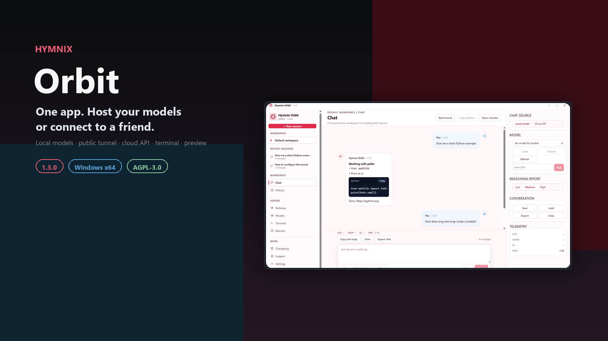
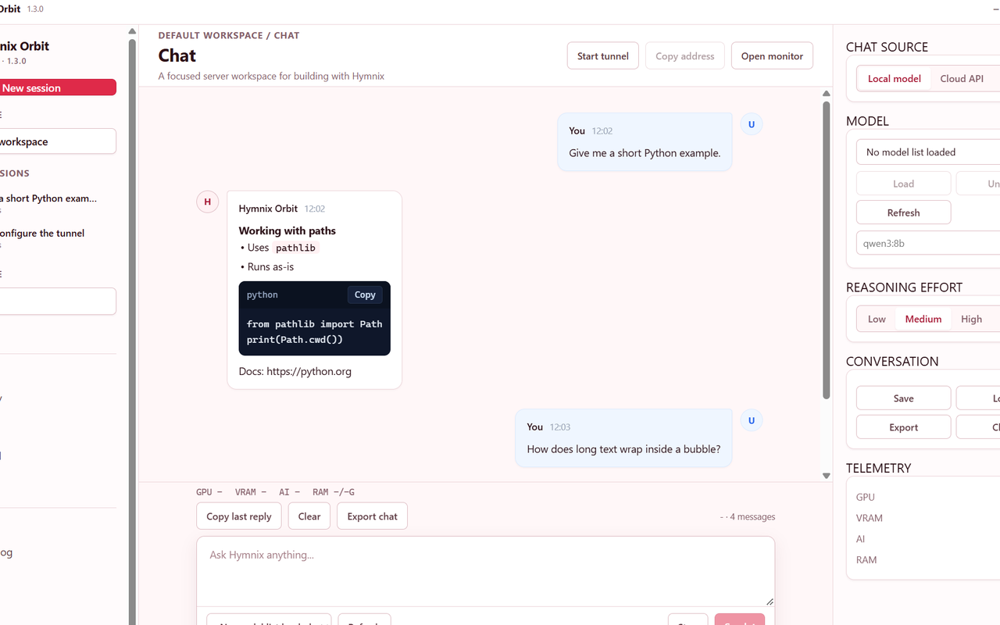
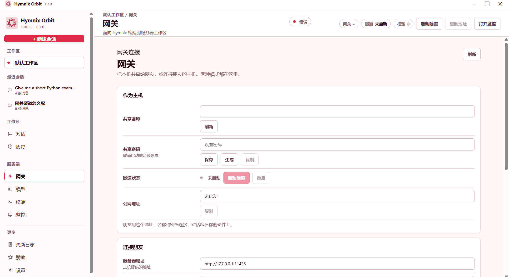
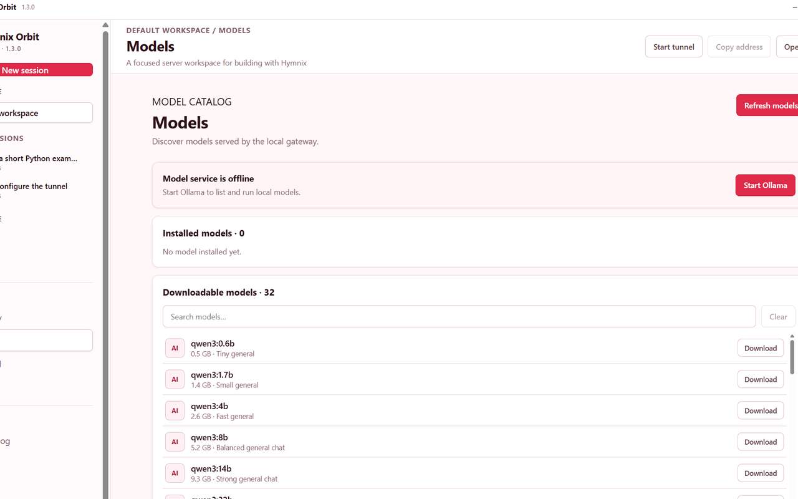
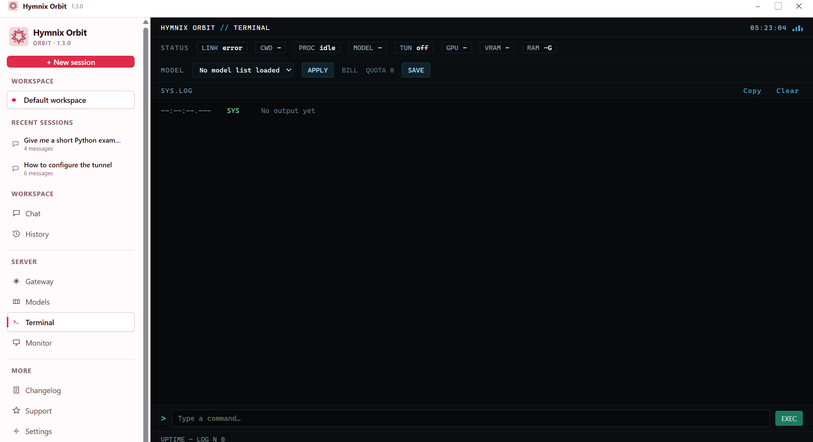
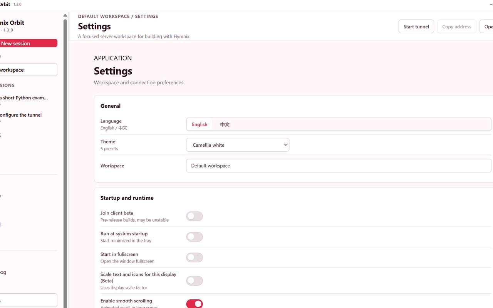
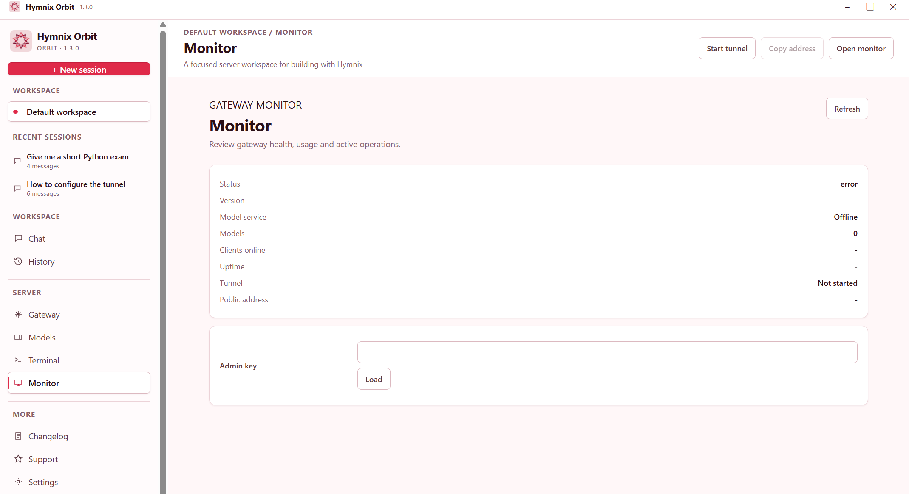

# Hymnix AI

**English** | [简体中文](README.zh-CN.md)

**A local-first AI gateway and Windows desktop console for running, sharing, and operating OpenAI-compatible local models.**

Hymnix connects Ollama-compatible models to a practical desktop workflow: chat, terminal operations, monitoring, tools, files, approvals, history, and optional remote access stay under the operator's control.


## Screenshots



| | |
|---|---|
|  |  |
|  |  |
|  |  |

More captures (chat, gateway, models, terminal, monitor, history, changelog, support, settings) are in [docs/images/orbit-1.3.0](docs/images/orbit-1.3.0). Screenshots of the previous 1.2 UI are kept in [docs/images/en](docs/images/en).

## What's new in 1.3.0 - Hymnix Orbit

- **One app, two roles.** The separate client and server builds from 1.0-1.2 are merged: the same app hosts your models for friends, or connects to a friend and uses their hardware.
- Host mode: share name, share password, and a one-click public tunnel with visible state and a live log.
- Guest mode: address, share name and connection password; the model list and chats come from the host.
- Cloud API as a second chat source, alongside local models.
- Downloadable model catalog with search, next to the installed list.
- Terminal console with a status strip, live tunnel log and gateway configuration commands.
- Chat with markdown, code copy and a collapsible thinking-process panel.
- Right control panel: model, reasoning effort, conversation save / load / export, GPU / VRAM / AI / RAM telemetry.
- In-app Chromium preview pane, or open in the default browser.
- Downloads: installer and portable builds are attached to the [v1.3.0 release](https://github.com/CarrisFlynn/hymnix-ai-server/releases/tag/v1.3.0).
- Details: [CHANGELOG.md](CHANGELOG.md) - Guide: [docs/OPERATIONS.md](docs/OPERATIONS.md) - Architecture: [docs/PROJECT.md](docs/PROJECT.md).

## What's new in 1.2.1

- Chinese text no longer turns into mojibake: every streamed reply, tool trace and log line is decoded as UTF-8.
- The sidebar can no longer open the wrong page: navigation resolves pages by id instead of by position.
- The terminal keeps its compact 1.2.0 density on high-DPI displays, and the window / taskbar icon is restored.
- History is read in full, searchable and exportable; terminal traces survive a restart.
- See [CHANGELOG.md](CHANGELOG.md) / [CHANGELOG.zh-CN.md](CHANGELOG.zh-CN.md).

## What's new in 1.2.0

- A full local AI workbench: 17 pages covering chat, terminal, monitoring, cloud endpoints, plugins, tools, crash reports, history, sessions, files, diffs, approvals, usage, OCR and git.
- Plugin kernel with manifests, permission allowlists and lifecycle controls; built-in tools plus MCP (stdio/HTTP) with approval gates.
- Multi-session history, context compression, file tree and search, hunk-level diff apply and rollback.
- Per-request usage and cost visibility, cloud hub, git acceleration, and a hardened one-click update path.
- English-first interface with Chinese, French, Russian and Spanish; full high-DPI rendering.

## Features

### Local gateway and OpenAI-compatible API

- Local HTTP gateway with OpenAI-compatible chat completions, streaming, usage data, and tool-call responses.
- Ollama model passthrough, model aliases, configurable compatibility modes, and upstream error normalization.
- Localhost-first defaults, separate model and administration credentials, and per-caller request serialization.

### Models and hardware

- Select any installed local model instead of being tied to a single default.
- Model discovery and refresh inside the app.
- Live hardware signals including GPU utilization, VRAM, power, latency, tokens, and estimated energy cost.
- Idle unloading and agent-aware keep-alive settings to balance responsiveness and resource use.

### Terminal console

- Keyboard-driven terminal page with status chips, live logs, command history, completion, and confirmation for destructive actions.
- Commands for service control, model selection, configuration, tunnel state, hardware, history, export, and log inspection.

### Multiple sessions and context compression

- Multiple conversation sessions with persistent local history, search, message browsing, statistics, and refresh.
- Context trimming preserves system instructions and can compress long conversations before sending.
- Session deletion creates a backup before removal.

### Plugin kernel and permissions

- Manifest-based plugins with permission declarations, allowlists, install/update/remove flows, and isolated lifecycle controls.
- Package validation, timeout limits, enable/disable controls, and a recoverable trash area for removed plugins.

### Tool calling and MCP

- Built-in tools with schema validation, safe expression evaluation, root-directory boundaries, and a visible invocation timeline.
- MCP stdio and HTTP transport support for compatible tool servers.
- Tool access can be gated by approval rules before execution.

### Files, repositories, and diffs

- Read-only file trees, filename and text search, filtering, scan statistics, and bounded workspace access.
- Diff preview with hunk-level review, apply, revert, backup, and rollback records.
- Repository-aware workflows for inspecting project files without granting unrestricted filesystem access.

### Approvals and security

- Human confirmation for risky commands, tools, plugin operations, and other sensitive actions.
- DNS and private-network checks, loopback and redirect protections, undeclared-argument rejection, and bounded roots.
- Conversation and event records remain local by default; treat them as sensitive because prompts and responses may be stored.

### Usage and cost

- Request history with latency, token, GPU, VRAM, power, and estimated cost fields.
- Usage summaries and exportable records for local operations and supported remote services.

### Cloud Hub

- Optional cloud endpoint configuration for compatible providers.
- Cloud usage reconciliation, account-aware status, and offline-friendly local behavior when remote credentials are unavailable.

### OCR

- OCR page and tool integration using a locally installed Tesseract-compatible engine when available.
- Clear availability reporting when no OCR engine is installed; OCR is optional and remains local.

### Git acceleration

- Local Git proxy settings and repository-focused inspection flows for development work.
- Git-aware diff and status workflows complement the file tree and review pages.

### Updates and publishing

- One-click update checks with release notes, progress, SHA-256 verification, and restart into the downloaded build.
- Update channels and publishing preparation are kept separate from the running executable.

### Languages and high DPI

- English, Simplified Chinese, French, Russian, and Spanish interface options.
- Windows desktop UI with language selection; verify rendering on your display scaling before deployment.

## Quick start

### Prerequisites

- Windows 10 or 11, Python 3.11 or newer for source runs.
- [Ollama](https://ollama.com/download) with at least one installed model.
- Optional: a local Tesseract-compatible OCR engine and a tunnel client for remote access.

### Run a prebuilt build

1. Download the server executable from the project's Releases page.
2. Start it in a dedicated folder.
3. Install or select a local model in Ollama.
4. Open the console, verify the gateway and model status, then configure an OpenAI-compatible client with the displayed endpoint and generated API key.

### Run from source

```powershell
git clone https://github.com/CarrisFlynn/hymnix-ai-server.git
cd hymnix-ai-server/server
python -m venv .venv
.\.venv\Scripts\Activate.ps1
pip install -r requirements.txt
python hymnix_main.py
```

Set HYMNIX_LANG (en, zh, fr, ru, es) to force the interface language, for example `$env:HYMNIX_LANG = "en"`.

## Build from source

The app has two build steps: the Electron desktop shell in desktop/ and the Python gateway in server/.

```powershell
cd server
python -m PyInstaller hymnix-server.spec --noconfirm --clean --distpath ..
```

```powershell
cd desktop
pnpm install
pnpm typecheck; pnpm test; pnpm build
pnpm exec electron-builder --win --x64 --dir
```

This produces hymnix-server-<version>-x64.exe in the repository root and Hymnix-Orbit-<version>-Setup.exe / -Portable.exe under release/.

Release checklist: clean build, launch the app, run typecheck and tests, sign the artifacts, write SHA256SUMS.txt next to them, and never commit local configuration, logs or credentials.

## Repository layout

```
desktop/     Electron + React app (main, preload, renderer, tests, scripts)
server/      Python gateway (gateway_core.py, hxcore modules, packaging spec)
             server/legacy holds the retired Tk UI and is never packaged
client/      legacy thin client from 1.0-1.2, kept for reference only
docs/        guides, screenshots, architecture and signing notes
config/      example configuration files (no secrets)
packaging/   MSIX packaging assets
release-1.3.0/  published installer, portable build and release documents
```

## Security notes

- The gateway is local-first and requires an API key for model requests and a separate administration key for administrative endpoints.
- Optional tunnels expose the gateway beyond the local machine; start them deliberately and share credentials only with trusted users.
- Conversation logs can contain full prompts, responses, file paths, and tool results. Protect the host account and clear or archive records when appropriate.
- Keep the server, tunnel client, OCR engine, model runtime, and dependencies up to date.
- Review every tool, plugin, diff, and approval request before allowing an action to run.

## Roadmap

- More efficient incremental rendering for long streaming responses.
- Broader MCP interoperability and richer tool-call presentation.
- Additional repository workflows and scalable virtualized lists.
- More provider integrations with explicit offline behavior and user-supplied credentials.

## License

Hymnix AI is licensed under the [GNU Affero General Public License v3.0](LICENSE).

## Contributing

Read [CONTRIBUTING.md](CONTRIBUTING.md), [SECURITY.md](SECURITY.md), and the documentation in `docs/` before opening an issue or pull request. Keep changes focused, document user-visible behavior, add regression coverage where practical, and never include credentials or private conversation data.

---

## What is new in 1.3.0 — Hymnix Orbit

**One app, two roles.** The separate client and server builds from 1.0–1.2 are merged: the same app can host your models for friends, or connect to a friend and use their hardware. Hosting and connecting live on one **Gateway** page.

- Host mode: share name, share password, one-click public tunnel with visible state and live log
- Guest mode: address, share name and connection password; model list and chats come from the host
- Local mode: everything stays on this machine, no tunnel and no account
- Cloud API as a second chat source
- Model catalog with search, separate installed and downloadable lists
- Terminal console with status strip, live tunnel log and gateway config commands
- Chat with markdown, code copy and a collapsible thinking-process panel
- Right control panel: model, reasoning effort, conversation save/load/export, GPU / VRAM / AI / RAM telemetry
- In-app Chromium preview pane, or open in the default browser
- Settings for startup, fullscreen, display scaling, smooth scrolling, GPU acceleration, cache folder and preview mode

Full list: [CHANGELOG.md](CHANGELOG.md) · Guide: [docs/OPERATIONS.md](docs/OPERATIONS.md) · Architecture: [docs/PROJECT.md](docs/PROJECT.md)

### Downloads

| Package | File |
|---|---|
| Installer | [Hymnix-Orbit-1.3.0-Setup.exe](https://github.com/CarrisFlynn/hymnix-ai-server/releases/download/v1.3.0/Hymnix-Orbit-1.3.0-Setup.exe) |
| Portable | [Hymnix-Orbit-1.3.0-Portable.exe](https://github.com/CarrisFlynn/hymnix-ai-server/releases/download/v1.3.0/Hymnix-Orbit-1.3.0-Portable.exe) |


