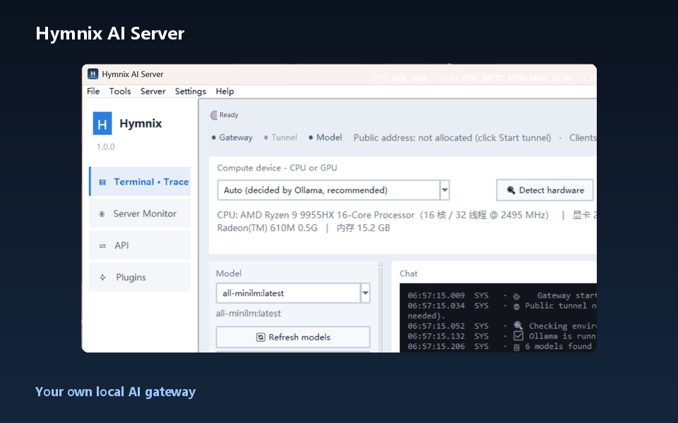
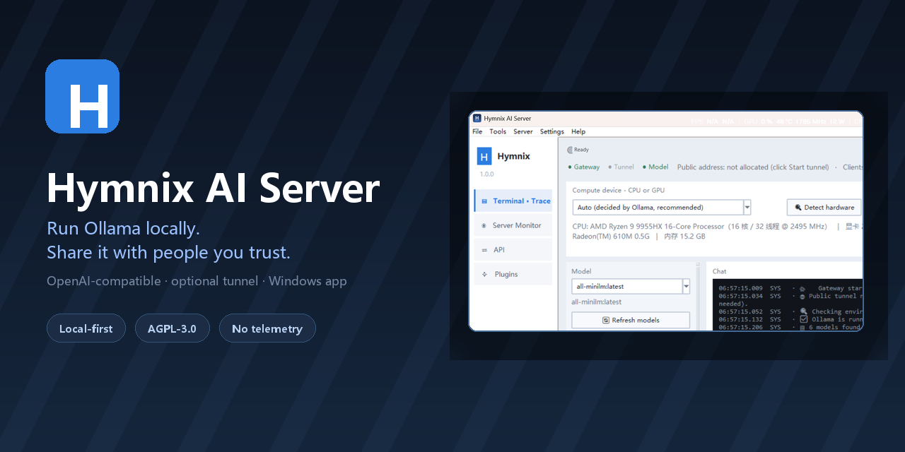

<p id="lang-switch"><a href="#english">English</a> | <a href="#chinese">简体中文</a></p>

# Hymnix AI Server

**Run a private AI gateway on your own computer, share it with people you trust, and keep a clear picture of what your shared endpoint is doing.**

Hymnix turns a local [Ollama](https://ollama.com) model into an OpenAI-compatible API, wraps it in a clean Windows desktop app, and optionally exposes it through a public tunnel. People you invite can use your GPU from anywhere, while you keep a console for troubleshooting and resource tracking.

**Local-first.** No accounts, no cloud, no telemetry. Only people you invite can connect, and only while the tunnel is running. They should know their requests are processed on your machine and logged locally - you can clear those logs at any time.

---


## Screenshots






## Highlights

- **Local models** - anything Ollama can run; 8 GB VRAM is enough for qwen3:8b.
- **OpenAI-compatible API** - /v1/chat/completions, streaming and non-streaming, tool calling included.
- **Live console** - a request log for troubleshooting and resource tracking: latency, tokens, GPU utilisation, VRAM, power and estimated cost.
- **Optional public access** - Cloudflare Tunnel (default) or ngrok, started on demand.
- **Desktop client included** - a ready-to-use app for the people you invite; it can also point at any OpenAI-compatible service.
- **Idle-aware** - the model is unloaded from VRAM after 60 seconds of inactivity (configurable).
- **Safe defaults** - gateway binds to localhost, API keys are generated locally, logs stay on the host.

## Quick start

### 1. Install Ollama

```powershell
winget install Ollama.Ollama
ollama pull qwen3:8b
```

### 2. Get the server

**Option A - prebuilt:** download Hymnix-AI-Server.exe from the Releases page.

**Option B - from source:**

```powershell
git clone https://github.com/YOUR-ACCOUNT/hymnix-ai-server.git
cd hymnix-ai-server
pip install -r client/requirements.txt pyinstaller
.\build.ps1
```

### 3. Start it

The server listens on 127.0.0.1:11435. Configuration, keys and logs live in:

```
%LOCALAPPDATA%\Hymnix\
```

On first run a random API key and admin key are generated into gateway_config.json.

### 4. Invite someone

1. In the status bar click **Start Tunnel**.
2. When the address appears, click **Copy** - URL and API key are copied together.
3. Send the client plus that text to your friend.

The tunnel is **manual on purpose**: every new tunnel allocates a public hostname, so creating one at startup wastes quota and may be rate-limited.

### 5. Connect the client

In Hymnix-Client.exe open **Settings -> AI interface**:

| Field | Value |
|---|---|
| Endpoint | https://YOUR-TUNNEL/v1 |
| API key | the key from step 4 |
| Model | qwen3:8b (or any model you pulled) |

## Architecture

```
 Hymnix-Client.exe                      Hymnix-AI-Server.exe
 +--------------+   HTTPS (tunnel)    +---------------------+
 | chat UI      | ------------------> | gateway (11435)     |
 | tools        | <------------------ |  - OpenAI-compatible|
 +--------------+                     |  - compat modes     |
                                      |  - request logging  |
                                      |  - metrics / energy |
                                      +----------+----------+
                                                 | HTTP
                                      +----------v----------+
                                      | Ollama (11434)      |
                                      |  qwen3:8b, ...      |
                                      +---------------------+
```

- The gateway is a standard-library Python HTTP server: no framework, no database.
- Conversations are appended to JSONL files under %LOCALAPPDATA%\Hymnix\logs\.
- compat_mode adapts to different clients: auto, openai, text_tools, plain, json_only.

More detail: [docs/ARCHITECTURE.md](docs/ARCHITECTURE.md).

## API

```bash
curl https://YOUR-TUNNEL/v1/chat/completions \
  -H "Authorization: Bearer YOUR_API_KEY" \
  -H "Content-Type: application/json" \
  -d '{"model":"qwen3:8b","messages":[{"role":"user","content":"Hello"}]}'
```

| Path | Auth | Description |
|---|---|---|
| GET /health | none | Server and model status |
| GET /api/tags | api key | List Ollama models |
| POST /api/chat | api key | Ollama-native chat |
| POST /v1/chat/completions | api key | OpenAI-compatible chat (+ tools, streaming) |
| GET /admin/status | admin key | Clients, stats, recent requests |
| POST /admin/cleanup | admin key | Filtered log cleanup (archives first) |

Examples: [examples/](examples/).

## Models

Hymnix does not force any particular model. The client sends model: <name> and the gateway forwards it to Ollama unchanged (unless you configure aliases).

- List installed models: ollama list, or GET /api/tags on the gateway.
- Pick the model in the client: Settings -> AI interface -> model (refreshes from the server).
- Use a default when a client omits the model: set default_model in gateway_config.json.
- Map a client model name to a different local model: model_aliases, for example {"gpt-4o-mini": "qwen3:8b"}.
- If the model is not installed, Ollama returns "model not found" - pull it, or map it.

## Configuration

Edit %LOCALAPPDATA%\Hymnix\gateway_config.json and restart:

| Key | Default | Meaning |
|---|---|---|
| listen_port | 11435 | Gateway port |
| api_key / admin_key | generated | Client key / admin key |
| model_aliases | {} | Map client model names to real Ollama models |
| compat_mode | auto | Client compatibility strategy |
| idle_unload_seconds | 60 | Unload model from VRAM after idle |
| keep_alive_agent | 300 | Keep-alive for tool-using agents |
| prompt_char_limit | 26000 | Prompt trimming budget (system prompts always kept) |
| ctx_expand_threshold | 45000 | Auto-expand context when prompt and tools exceed this |

## Security

- The gateway binds to 127.0.0.1; friends reach it only through the tunnel you start.
- Never share admin_key - it unlocks monitoring, logs and cleanup.
- Conversation logs contain full prompts and replies; they are private data.
- See [SECURITY.md](SECURITY.md) and [docs/PRIVACY.md](docs/PRIVACY.md).

## Build from source

```powershell
.\build.ps1               # both executables -> dist/
.\build.ps1 -ServerOnly
.\build.ps1 -ClientOnly
```

Microsoft Store package (MSIX):

```powershell
.\build.ps1 -ServerOnly
.\build-msix.ps1 -Version 1.0.0.0
```

Requires Windows SDK 10 (makeappx.exe). See [docs/STORE.md](docs/STORE.md).

## Documentation

| Document | Contents |
|---|---|
| [docs/SETUP.md](docs/SETUP.md) | Install, run, tunnel, LAN mode, ports |
| [docs/CLIENT.md](docs/CLIENT.md) | Client usage and AI endpoint settings |
| [docs/ARCHITECTURE.md](docs/ARCHITECTURE.md) | How the gateway works internally |
| [docs/FAQ.md](docs/FAQ.md) | Common problems |
| [docs/STORE.md](docs/STORE.md) | Microsoft Store packaging |
| [docs/PRIVACY.md](docs/PRIVACY.md) | What is stored and where |
| [docs/zh-CN/](docs/zh-CN/) | Chinese translations |


## Support this project

Hymnix is free and open source (AGPL-3.0). If it saves you time, you can support development:

- [爱发电 / Afdian](https://ifdian.net/a/hymnixstudio) - one-time or monthly support
- Star the repository and share it with someone who runs local models

Paid support, custom builds and deployment help are available on request.

## Contributing

Issues and pull requests are welcome - see [CONTRIBUTING.md](CONTRIBUTING.md). Please read [CODE_OF_CONDUCT.md](CODE_OF_CONDUCT.md) first.


## Contact

- Email: shayhymnix@gmail.com
- X / Twitter: [@ShayHymnix](https://x.com/ShayHymnix)
- Bugs and feature requests: [GitHub Issues](../../issues)

---

# 中文操作指南

<p id="chinese"></p>

[English version above](#hymnix-ai-server) · **简体中文**

## 一、第一次运行

1. 安装 Ollama：winget install Ollama.Ollama（或从 ollama.com 下载）
2. 拉模型：ollama pull qwen3:8b
3. 双击 Hymnix-AI-Server.exe
4. 等状态栏「网关」「模型」两个圆点变绿
5. 配置和日志在 %LOCALAPPDATA%\Hymnix\，可通过「文件 → 打开数据目录」打开

## 二、启动公网隧道

隧道是手动申请的——每开一次都会占用一个公网地址。

1. 点状态栏的「启动隧道」
2. 第一次会自动下载 cloudflared（约 55MB）
3. 地址出现后点「复制地址」（会把地址和 API Key 一起复制）
4. 把这段文字发给朋友

不想分享时点「停止隧道」，地址立即失效。

## 三、邀请朋友

发给他两样东西：Hymnix-Client.exe + 刚才复制的文字。

他在客户端里打开「设置 → AI 接口」填：

| 字段 | 填什么 |
|---|---|
| 接口地址 | 复制的地址 + /v1 |
| API Key | 复制的密钥 |
| 模型 | qwen3:8b |

然后「测试连接」→「保存」。

## 四、排障视图（服务端监控）

这里只用于你自己排查问题和看资源占用。被邀请的人知道请求会经你的电脑处理，日志也可以随时清理。切到「服务端监控」：

- 左列：已连接客户端（IP、请求数、最近活跃）
- 右表：每条请求一行，点开可看完整提示词、思考、工具调用、回复、能耗
- 筛选：时间范围、来源 IP、关键词

## 五、清理日志

1. 点「清理历史…」
2. 选日期范围、IP、关键词（至少给一个条件）
3. 「预览」看匹配多少条
4. 「执行清理」：先归档到 logs/archive/，再移除

归档目录不删，数据就一直保留。

## 六、模型选择

Hymnix 不强制任何模型：客户端传什么模型名，就发给 Ollama 什么模型（只有配了别名才会映射）。

- 看已装模型：ollama list，或网关的 GET /api/tags
- 客户端里选：设置 → AI 接口 → 模型（会从服务器刷新列表）
- 客户端不传模型时的默认值：在 gateway_config.json 里配 default_model
- 映射到别的本地模型：model_aliases，例如 {"gpt-4o-mini": "qwen3:8b"}
- 模型没装会报 model not found：先 ollama pull，或加映射

## 七、切换模型

- 左侧「模型」下拉切换已装模型
- 「刷新模型」重新扫描 Ollama
- 「下载模型」打开模型货架（搜索 / 体积 / 显存要求）
- 计算设备条上「应用」可绑定 GPU 或强制 CPU

空闲 60 秒后模型会自动从显存卸载（配置项 idle_unload_seconds）。

## 八、改端口 / 密钥

编辑 %LOCALAPPDATA%\Hymnix\gateway_config.json 后重启：

| 字段 | 说明 |
|---|---|
| listen_port | 网关端口 |
| api_key | 朋友用的密钥 |
| admin_key | 你的监控/管理密钥，绝不外发 |
| model_aliases | 映射客户端传来的模型名 |
| compat_mode | auto / openai / text_tools / plain / json_only |

## 九、常用操作

| 想做什么 | 怎么做 |
|---|---|
| 看谁连着 | 服务端监控 → 左列 |
| 查公网地址 | 状态栏 |
| 马上停止分享 | 停止隧道 |
| 立刻释放显存 | 等 60 秒，或重启程序 |
| 开关界面音效 | 插件页 → 界面音效 |
| 打开数据目录 | 文件 → 打开数据目录 |

## License

[AGPL-3.0](LICENSE). If you modify Hymnix and run it as a network service, you must offer the modified source to its users.
