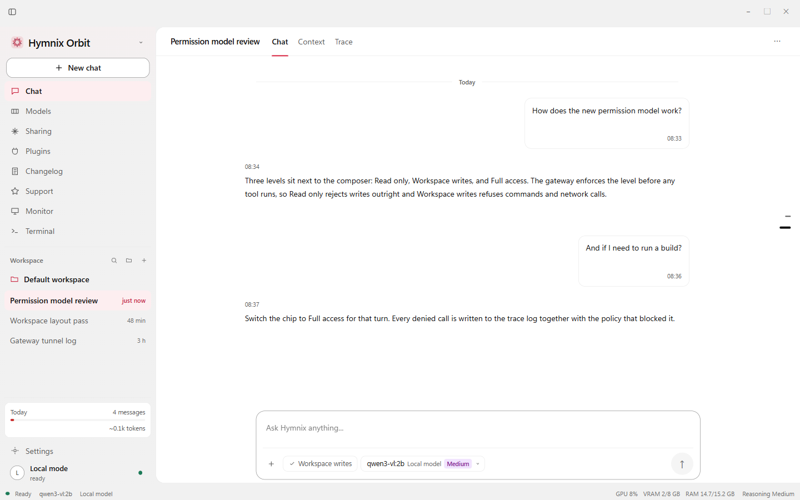
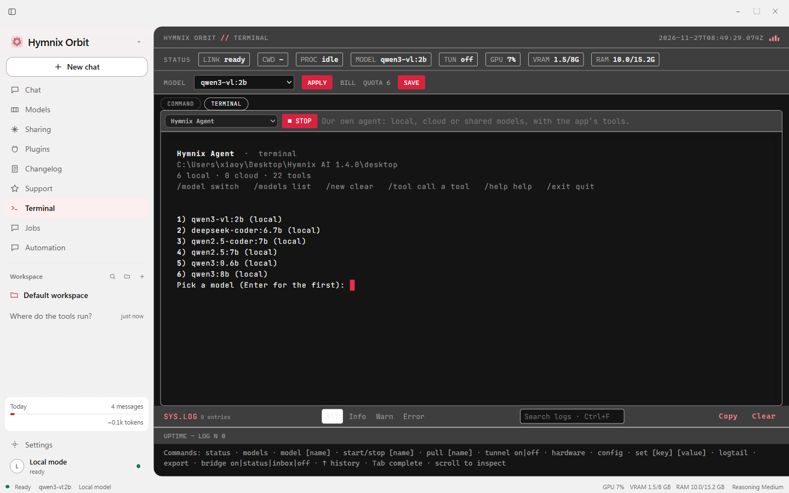
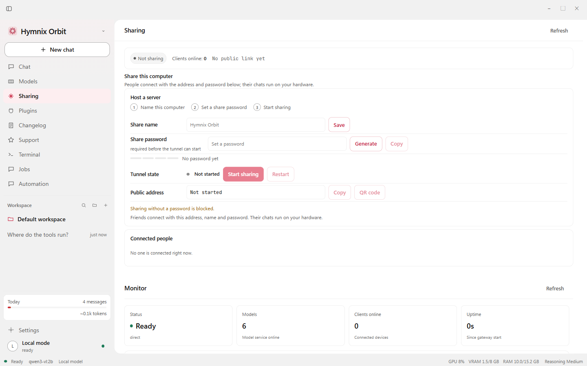

# Hymnix Orbit

**A local-first AI workbench for Windows.** Run models on your own machine, point at a cloud API when you want one, or let a friend lend you theirs — with a real terminal, real tools, and approvals that stay on the machine the work happens on.

[](https://github.com/CarrisFlynn/hymnix-ai-server/releases)
[](LICENSE)
[](#requirements)
[](server/)

[简体中文](README.zh-CN.md) · [Changelog](CHANGELOG.md) · [Security](SECURITY.md)

---

## Screenshots

| | |
|---|---|
|  |  |
| **Orbit chat** — the agent loop, with plan and trace on the same page. | **Terminal** — a real PTY: the built-in agent, PowerShell, Claude Code, Codex, Gemini, Ollama or Git Bash. |
|  |  |
| **Models** — local models, downloads and hardware in one place. | **Sharing** — lend your hardware, or connect to someone who does. |

---

## What it is

Hymnix Orbit is a desktop AI workbench with two surfaces:

- **Orbit** — the agent. It reads, edits and runs things, with a plan, a trace, and an approval before anything dangerous.
- **Hymnix AI** — plain chat, when you just want an answer.

Under both, one rule: **the model can live anywhere, but work happens where the files are.**

| You want | What happens |
|---|---|
| Your own models | Ollama runs locally; nothing leaves the machine |
| A cloud model | Called directly with your own key; no gateway involved |
| A friend's machine | Their model answers, *your* computer runs the tools |

---

## Quick start

### Install

Download `Hymnix-Orbit-1.5.0-Setup.exe` from [Releases](https://github.com/CarrisFlynn/hymnix-ai-server/releases), or use the portable build — no install. Node is bundled, so the built-in terminal agent works out of the box.

### Run a model

Install [Ollama](https://ollama.com) and pull something:

```powershell
ollama pull qwen3:8b
```

Or skip local models entirely: **Settings → Models → API**, then add a provider.

### From source

```powershell
pnpm install
pnpm build            # renderer + main
pnpm build:backend    # the Python gateway (optional; needed for sharing)
pnpm dev              # development build with probe hooks
```

---

## Features

### The agent (Orbit)
One loop that plans, calls tools and shows its work. Context, plan and trace are tabs beside the conversation, so you can see what it read before it answered.

### The terminal
A real PTY, not a log view — cursor addressing, raw keys, alternate screen. That means the terminal page can host:

- **Hymnix Agent** — this app's kernel in CLI form: the same tools, the same approvals, as `y/N` in the terminal.
- **Claude Code, Codex, Gemini, Ollama, Git Bash, PowerShell** — discovered on your machine, not assumed.

The agent CLI carries no tools and no provider logic. A loopback bridge with a fresh token per run owns both, so the model can be local, cloud or shared without the CLI knowing.

### Tools
53 tools across files, patches, repositories, commands, terminals, web, models, sessions, jobs, schedules, skills and subagents. The file, patch, repository, command, terminal and fetch tools live **in the desktop process itself**, so they answer with the gateway stopped — which is the normal case.

The port kept their boundaries, not just their features: paths resolve through realpath before the containment test, `web.fetch` refuses private destinations (IPv4-mapped IPv6 included) and pins the checked address, and a timed-out command is killed as a whole process tree.

### Approvals
Anything that writes, deletes or runs asks first. The policy sits next to the composer: **Read only**, **Workspace writes** or **Full access**. A denied call is still recorded in the trace, with the policy that blocked it.

### Models and hardware
Local models with load/unload and VRAM readouts, a downloadable catalog, per-provider keys, and a hardware strip that says what your machine can actually hold.

### Sharing
Lend your hardware, or use a friend's:

1. **Host** — name the machine, set a password, start sharing. You get a public address and a QR code.
2. **Guest** — enter the address and password. Their models appear in your model list; your files never leave your computer.

A shared session runs in Orbit only, and a guest is refused for `/api/tools` and `/api/files` outright: the host provides compute, not disk. The shared endpoint speaks both OpenAI and Anthropic Messages, so Claude Code or an Anthropic SDK can point at a shared model.

### Also
Plugins with a permission model, automation jobs, worktrees, skills, subagents, usage and cost tracking, nine themes that follow Windows, and a Chinese/English interface.

---

## Architecture

```text
Desktop (Electron)                     Optional gateway (Python)
  renderer — UI, agent loop              sharing only:
  main     — tools, PTY, LSP, bridge     tunnel, quotas, shared models
```

The gateway is **not** required to use the app. It exists so a machine can share what it has. Details: [docs/ARCHITECTURE.md](docs/ARCHITECTURE.md).

---

## Requirements

- Windows 10 (1809+) or Windows 11, x64
- 8 GB RAM minimum; 16 GB or more for larger models
- [Ollama](https://ollama.com) for local models (optional)
- Python 3.11+ only when running the gateway from source

---

## Repository layout

| Path | What lives there |
|---|---|
| `desktop/src/main` | Electron main: tools, PTY host, agent bridge, providers, LSP |
| `desktop/src/renderer` | React UI (single IIFE bundle, so `file://` works) |
| `desktop/cli` | The terminal agent |
| `desktop/tests` | Behavioural tests (`node:test`) |
| `server/` | Python gateway: sharing, tunnel, quotas |
| `server/tests` | Gateway and protocol tests |
| `docs/` | Architecture, operations, security, release notes |

---

## Build

```powershell
pnpm check            # typecheck + tests + design tokens + build
pnpm dist             # renderer, backend, installers into release/
pnpm smoke:prod       # boot the packaged artifact
```

The packager ships Node with the app and carries the bundled language server as one archive, because directory layouts containing `node_modules` are pruned during packaging.

---

## Security

- Tools and files are refused to guests: the host never reads its own disk on someone else's behalf.
- A shared endpoint counts failed keys toward the ban and honours the daily quota.
- Paths resolve to their real location before any containment check.
- Approvals are required before anything writes or runs.

See [SECURITY.md](SECURITY.md) and [docs/SECURITY.md](docs/SECURITY.md).

---

## Changelog

[CHANGELOG.md](CHANGELOG.md) · [简体中文](CHANGELOG.zh-CN.md)

---

## License

[AGPL-3.0](LICENSE). Commercial licensing available on request.

## Contributing

Issues and pull requests are welcome — see [CONTRIBUTING.md](CONTRIBUTING.md) and [CODE_OF_CONDUCT.md](CODE_OF_CONDUCT.md).
