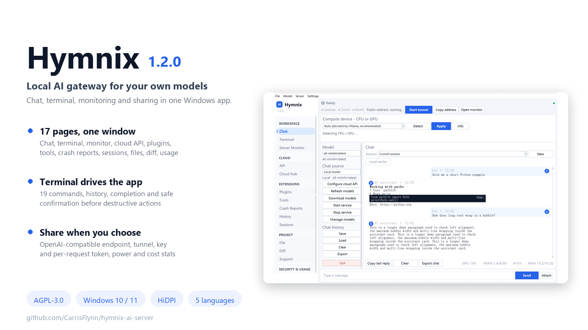
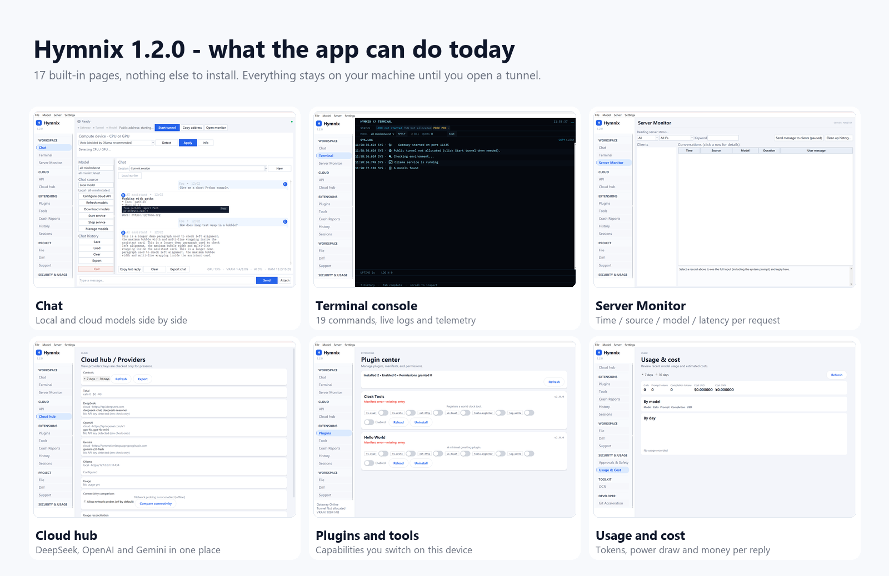
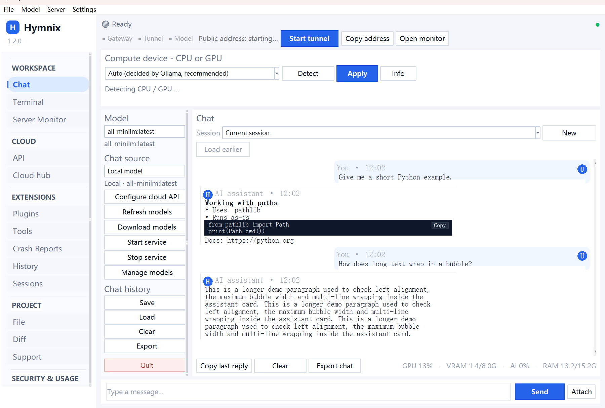
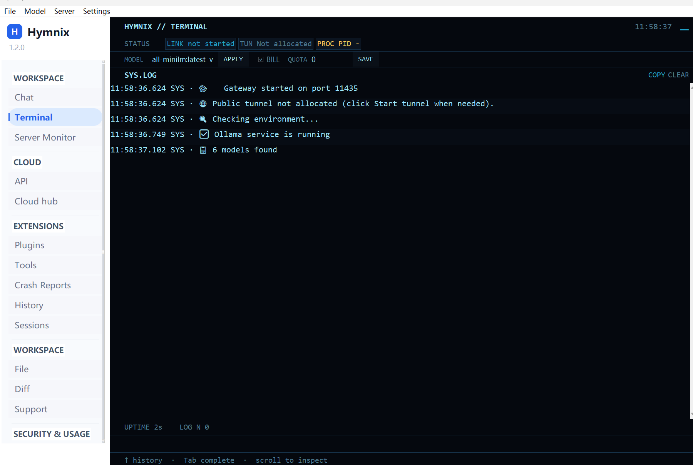
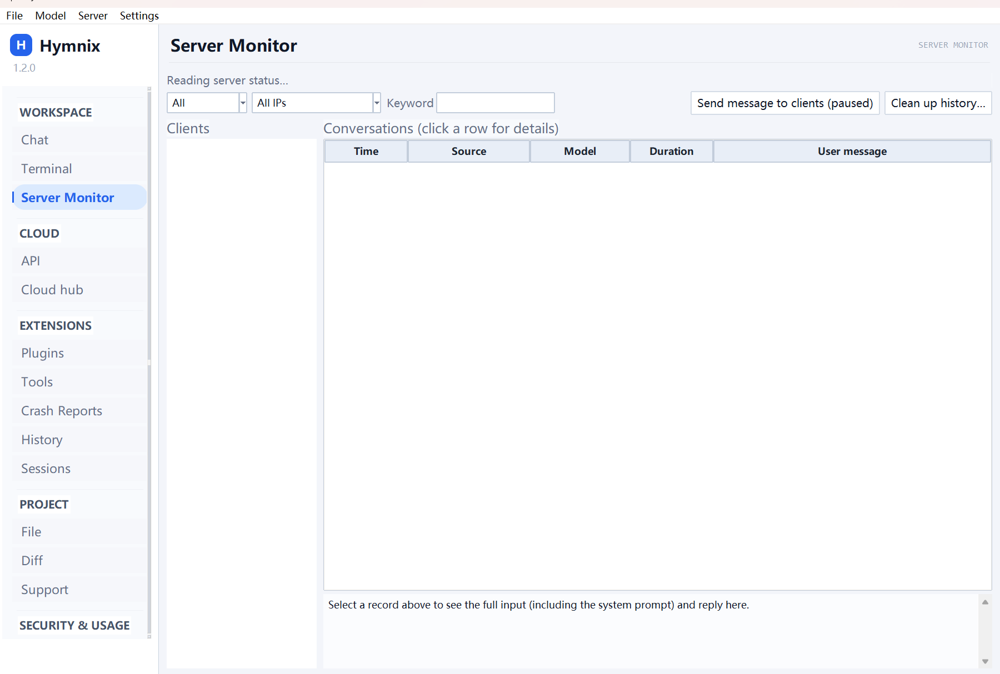
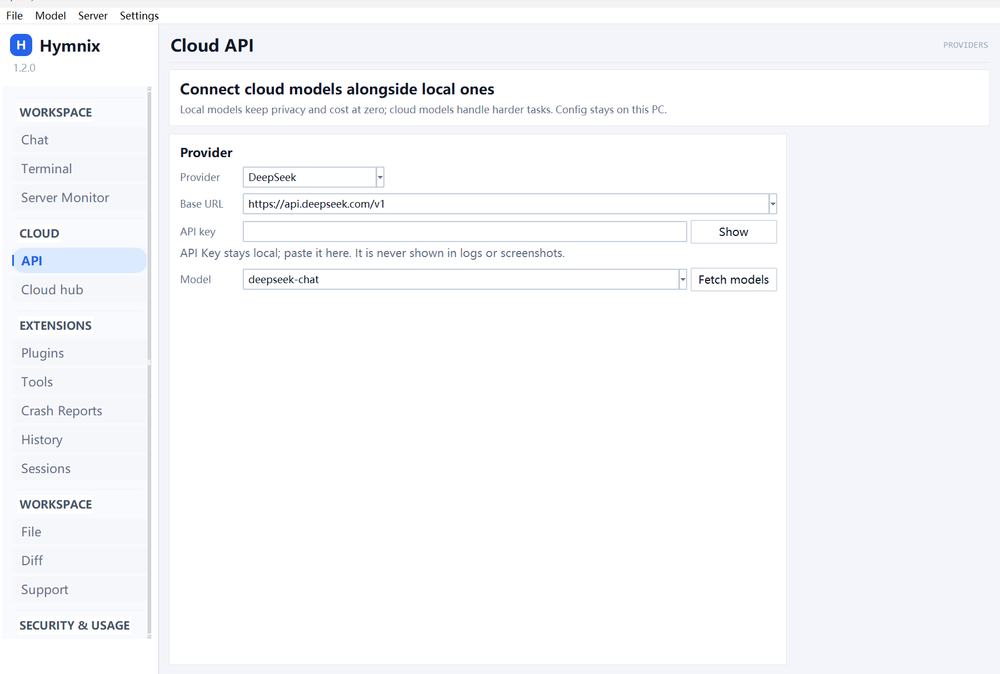
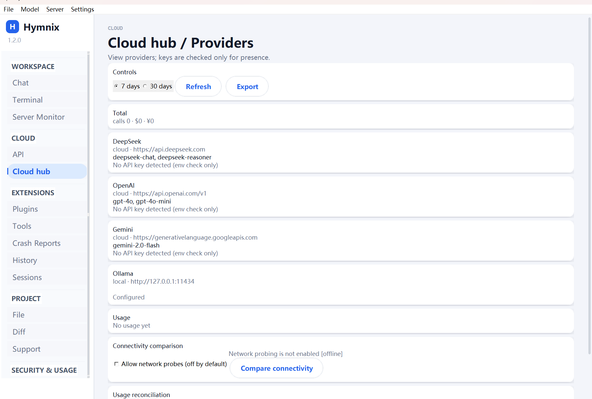
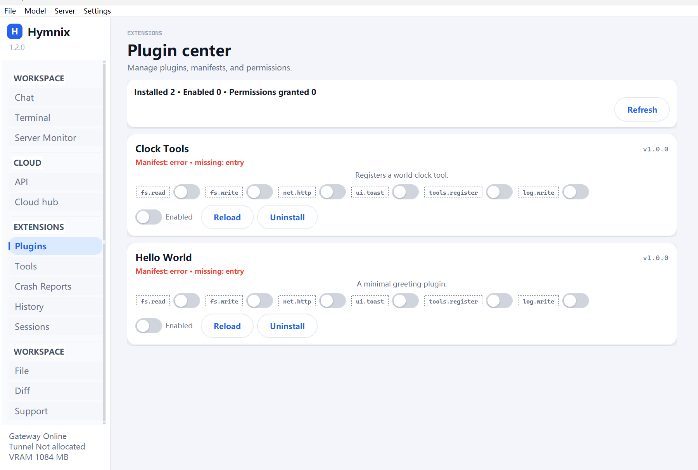

# Hymnix AI

**面向本地模型的 AI 网关与 Windows 桌面控制台：兼容 OpenAI 接口，并把对话、运维、工具和安全审批集中在本机。**

Hymnix 将 Ollama 兼容模型接入一套完整的桌面工作流：对话、终端操作、监控、工具、文件、审批、历史记录以及可选的远程访问，均由操作者掌控。


## 截图












## 功能

### 本地网关与 OpenAI 兼容接口

- 本地 HTTP 网关，支持 OpenAI 兼容的聊天补全、流式输出、用量数据和工具调用响应。
- Ollama 模型透传、模型别名、兼容模式，以及统一的上游错误处理。
- 默认本地优先，模型与管理凭据分离，并按客户端串行化请求。

### 模型与硬件

- 选择任意已安装的本地模型，不绑定单一默认模型。
- 桌面客户端可发现并刷新模型列表。
- 实时查看 GPU 利用率、显存、功耗、延迟、令牌数和估算能耗。
- 支持空闲卸载与面向工具代理的保持加载设置，在响应速度和资源占用之间取平衡。

### 终端控制台

- 键盘驱动的终端页面，提供状态芯片、实时日志、命令历史、补全，以及破坏性操作确认。
- 支持服务、模型、配置、隧道、硬件、历史、导出和日志检查等命令。

### 多会话与上下文压缩

- 多会话、本地持久化历史、搜索、消息浏览、统计和刷新。
- 长对话发送前可压缩上下文，并保留系统指令。
- 删除会话前自动创建备份。

### 插件内核与权限

- 基于清单的插件，支持权限声明、白名单、安装/更新/卸载和生命周期控制。
- 提供包校验、超时限制、启停控制，以及可恢复的删除暂存区。

### 工具调用与 MCP

- 内置工具支持 schema 校验、安全表达式计算、根目录边界和可见的调用时间线。
- 支持 MCP stdio 与 HTTP 传输。
- 工具执行可在运行前触发审批规则。

### 文件、仓库与 diff

- 只读文件树、文件名与文本搜索、过滤、扫描统计和受限工作区访问。
- 支持按 hunk 预览、应用、回滚、备份和回滚记录。
- 面向仓库的检查流程不要求授予无限制文件系统权限。

### 审批与安全

- 对高风险命令、工具、插件操作和其他敏感动作提供人工确认。
- 提供 DNS 与私网检查、回环与重定向防护、未声明参数拒绝和根目录边界。
- 对话与事件默认保存在本地；由于可能包含提示词和响应，应按敏感数据保护。

### 用量与成本

- 请求历史记录延迟、令牌、GPU、显存、功耗和估算成本。
- 支持本地操作及部分远程服务的用量汇总与记录导出。

### Cloud Hub

- 可选配置兼容服务商的云端接口。
- 支持云端用量对账、账户状态和无远程凭据时的离线友好行为。

### OCR

- 提供 OCR 页面与工具接入；本机安装兼容 Tesseract 的引擎后即可使用。
- 未安装引擎时明确报告可用性；OCR 可选且默认在本地处理。

### Git 加速

- 提供本地 Git 代理设置和面向仓库的检查流程。
- Git 感知的 diff 与状态工作流和文件树、审查页面协同使用。

### 更新与发布

- 一键检查更新、查看说明、显示进度、校验 SHA-256，并重启到已下载版本。
- 更新通道与发布准备流程和运行中的可执行文件分离。

### 多语言与高 DPI

- 支持英文、简体中文、法文、俄文和西班牙文界面。
- 提供支持多语言的 Windows 桌面界面；部署前请在目标显示缩放设置下确认渲染效果。

## 快速开始

### 前置条件

- Windows 10 或 11；从源码运行需要 Python 3.11 或更高版本。
- 安装 [Ollama](https://ollama.com/download)，并至少准备一个本地模型。
- 可选：本机 Tesseract 兼容 OCR 引擎，以及用于远程访问的隧道客户端。

### 运行预构建版本

1. 从项目 Releases 页面下载服务器可执行文件。
2. 将其放入专用目录并启动。
3. 在 Ollama 中安装或选择本地模型。
4. 打开控制台，确认网关和模型状态，然后使用界面显示的端点与生成的 API key 配置 OpenAI 兼容客户端。

### 从源码运行

```powershell
git clone https://github.com/CarrisFlynn/hymnix-ai-server.git
cd hymnix-ai-server
python -m venv .venv
.\.venv\Scripts\Activate.ps1
pip install -r client/requirements.txt
python source/hymnix_main.py
```

## 从源码构建

桌面构建使用 PyInstaller 与项目 spec 文件。在 `source` 目录中执行对应 spec，并使用干净的构建目录：

```powershell
python -m PyInstaller --noconfirm --clean --distpath . --workpath "$env:TEMP\hymnix-build" "Hymnix 1.1.0.spec"
```

发布构建应核对生成的可执行文件，运行自检和测试套件，并与制品一同发布校验和。不要把可变配置、日志或凭据放入仓库。

## 安全说明

- 网关默认本地优先；模型请求需要 API key，管理接口使用独立的管理 key。
- 可选隧道会把网关暴露到本机之外；请主动启动，并仅向可信用户分享凭据。
- 对话日志可能包含完整提示词、响应、文件路径和工具结果。请保护主机账户，并在需要时清理或归档记录。
- 及时更新服务器、隧道客户端、OCR 引擎、模型运行时和依赖。
- 允许执行前，逐项审查工具、插件、diff 和审批请求。

## 路线图

- 为长流式响应提供更高效的增量渲染。
- 扩展 MCP 互操作性与工具调用展示。
- 增加仓库工作流并扩大虚拟化列表覆盖。
- 增加更多服务商集成，同时明确离线行为并使用用户自行提供的凭据。

## 许可证

Hymnix AI 使用 [GNU Affero General Public License v3.0](LICENSE) 授权。

## 参与贡献

提交 issue 或 pull request 前，请阅读 [CONTRIBUTING.md](CONTRIBUTING.md)、[SECURITY.md](SECURITY.md) 和 `docs/` 中的文档。保持改动聚焦，记录面向用户的行为变化，适当补充回归覆盖，绝不要提交凭据或私人对话数据。

