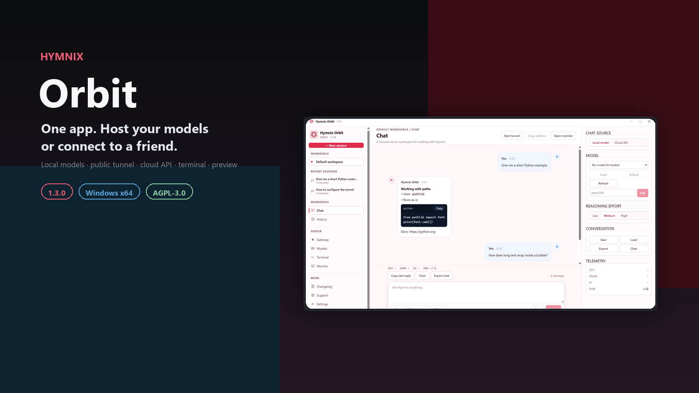
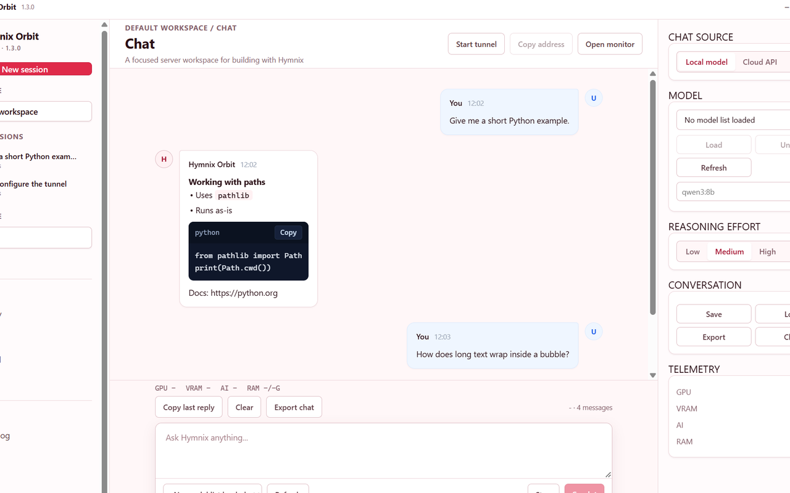
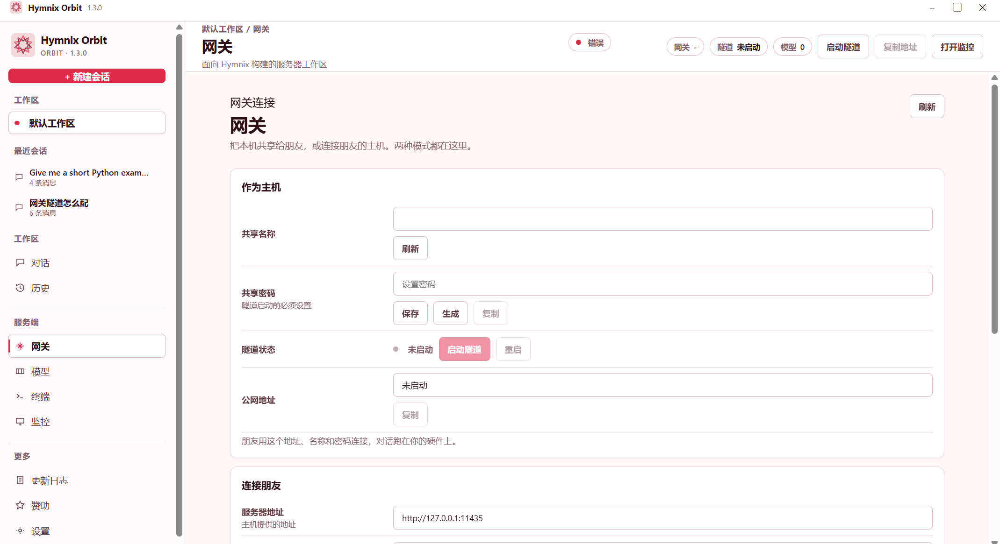
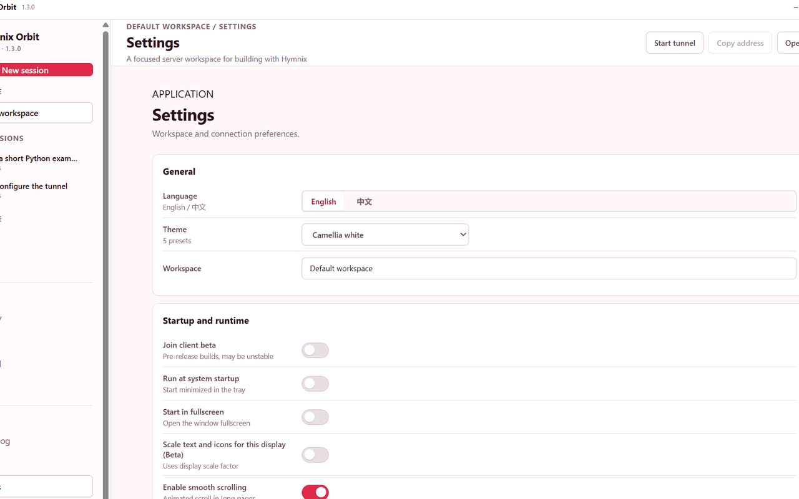

# Hymnix Orbit

[English](README.md) | **简体中文**

**面向本地模型的 AI 网关与 Windows 桌面控制台：兼容 OpenAI 接口，并把对话、运维、工具和安全审批集中在本机。**

Hymnix 将 Ollama 兼容模型接入一套完整的桌面工作流：对话、终端操作、监控、工具、文件、审批、历史记录以及可选的远程访问，均由操作者掌控。


## 截图



| | |
|---|---|
|  |  |
|  |  |
|  |  |

更多截图（对话、网关、模型、终端、监控、历史、更新日志、赞助、设置）见 [docs/images/orbit-1.3.0](docs/images/orbit-1.3.0)；1.2 旧界面截图保留在 [docs/images/en](docs/images/en)。

## 1.3.0 更新 - Hymnix Orbit

- **一个应用两种角色**：1.0-1.2 分开的客户端/服务端包已合并，同一个应用既能给朋友当模型主机，也能连朋友的机器用他的硬件。
- 主机模式：共享名称、共享密码、一键公网隧道，状态可见、日志实时。
- 访客模式：地址、共享名称、连接密码；模型列表与对话来自主机。
- 云端 API 作为第二种对话来源，与本地模型并存。
- 可下载的 Ollama 模型支持按名称或发布方搜索，并可按许可证、下载大小和估算显存筛选。
- 终端控制台：状态条、隧道实时日志、网关配置命令。
- 对话支持 Markdown、代码复制、思考过程折叠面板。
- 右侧控制栏：模型、推理强度、对话保存/加载/导出、GPU / VRAM / AI / RAM 遥测。
- 应用内 Chromium 预览，也可交回默认浏览器。
- 安装版与免安装版见 [v1.3.0 Release](https://github.com/CarrisFlynn/hymnix-ai-server/releases/tag/v1.3.0)。

### 底层重构

- **彻底去掉 Tk**：旧 Tkinter 页面退役并隔离在 server/legacy，打包产物不再包含 tkinter / ttk / Notebook。
- **网关变成无界面服务**：gateway_core.py 独立运行，负责 OpenAI 兼容对话、模型管理、隧道控制、云端配置、管理接口与健康检查。
- **单进程树托管**：Electron 主进程启动并守护打包后的网关，已健康的 1.3.0 网关直接复用，配合单实例锁。
- **只走 IPC**：渲染层不碰文件、网络和密钥，全部经 preload 桥；页面走特权 app:// 协议而不是 file://，模块与 CSP 才能正常工作。
- **不再手填密钥**：应用自己读取并注入本机网关密钥。
- **托管能力服务化**：主机身份、访客连接、公网隧道、云端 API、网关配置、Ollama 启停都是带鉴权的真实接口。
- **依赖更少**：目标机器不需要 Java、Node.js、WebView2，cloudflared 随包。

### UI 重构

- **新设计系统**：间距与字号体系、卡片与按钮基元、5 套主题、统一状态色，替换此前的临时样式。
- **信息架构重排**：对话、历史、网关、模型、终端、监控、更新日志、赞助、设置；删掉空占位页，网关从设置里独立成页。
- **对话重做**：气泡卡片 + 头像 + Markdown + 代码块复制 + 思考过程折叠；回车发送，Shift+回车换行。
- **终端重做为控制台**：状态条、隧道实时日志、status/models/tunnel/hardware/config 等命令。
- **新增右侧控制栏**：模型、推理强度、对话保存/加载/导出、GPU / VRAM / AI / RAM 遥测。
- **自绘窗口**：无边框窗口 + 设计过的标题栏，去掉原生菜单。
- **双语设计**：中英双语由词典驱动，主题名与设置标签也会跟随切换。

## 1.2.1 更新

- 中文不再乱码：流式回复、工具轨迹、日志一律按 UTF-8 解码。
- 侧栏不会再打开错的页面：页面按 id 解析，不再依赖顺序。
- 终端在高 DPI 屏幕下保持 1.2.0 的紧凑密度，窗口与任务栏图标已恢复。
- 聊天记录全量读取、可搜索、可导出；终端轨迹重启后仍在。
- 明细见 [CHANGELOG.zh-CN.md](CHANGELOG.zh-CN.md) / [CHANGELOG.md](CHANGELOG.md)。

## 功能

### 本地网关与 OpenAI 兼容接口

- 本地 HTTP 网关，支持 OpenAI 兼容的聊天补全、流式输出、用量数据和工具调用响应。
- Ollama 模型透传、模型别名、兼容模式，以及统一的上游错误处理。
- 默认本地优先，模型与管理凭据分离，并按客户端串行化请求。

### 模型与硬件

- 选择任意已安装的本地模型，不绑定单一默认模型。
- 桌面客户端可发现并刷新模型列表。
- 实时查看 GPU 利用率、显存、功耗、延迟、令牌数和估算能耗。
- 支持空闲卸载与面向工具代理的保持加载设置，在响应速度和资源占用之间取平衡。

### 终端控制台

- 键盘驱动的终端页面，提供状态芯片、实时日志、命令历史、补全，以及破坏性操作确认。
- 支持服务、模型、配置、隧道、硬件、历史、导出和日志检查等命令。

### 多会话与上下文压缩

- 多会话、本地持久化历史、搜索、消息浏览、统计和刷新。
- 长对话发送前可压缩上下文，并保留系统指令。
- 删除会话前自动创建备份。

### 插件内核与权限

- 基于清单的插件，支持权限声明、白名单、安装/更新/卸载和生命周期控制。
- 提供包校验、超时限制、启停控制，以及可恢复的删除暂存区。

### 工具调用与 MCP

- 内置工具支持 schema 校验、安全表达式计算、根目录边界和可见的调用时间线。
- 支持 MCP stdio 与 HTTP 传输。
- 工具执行可在运行前触发审批规则。

### 文件、仓库与 diff

- 只读文件树、文件名与文本搜索、过滤、扫描统计和受限工作区访问。
- 支持按 hunk 预览、应用、回滚、备份和回滚记录。
- 面向仓库的检查流程不要求授予无限制文件系统权限。

### 审批与安全

- 对高风险命令、工具、插件操作和其他敏感动作提供人工确认。
- 提供 DNS 与私网检查、回环与重定向防护、未声明参数拒绝和根目录边界。
- 对话与事件默认保存在本地；由于可能包含提示词和响应，应按敏感数据保护。

### 用量与成本

- 请求历史记录延迟、令牌、GPU、显存、功耗和估算成本。
- 支持本地操作及部分远程服务的用量汇总与记录导出。

### Cloud Hub

- 可选配置兼容服务商的云端接口。
- 支持云端用量对账、账户状态和无远程凭据时的离线友好行为。

### OCR

- 提供 OCR 页面与工具接入；本机安装兼容 Tesseract 的引擎后即可使用。
- 未安装引擎时明确报告可用性；OCR 可选且默认在本地处理。

### Git 加速

- 提供本地 Git 代理设置和面向仓库的检查流程。
- Git 感知的 diff 与状态工作流和文件树、审查页面协同使用。

### 更新与发布

- 一键检查更新、查看说明、显示进度、校验 SHA-256，并重启到已下载版本。
- 更新通道与发布准备流程和运行中的可执行文件分离。

### 多语言与高 DPI

- 支持英文、简体中文、法文、俄文和西班牙文界面。
- 提供支持多语言的 Windows 桌面界面；部署前请在目标显示缩放设置下确认渲染效果。

## 快速开始

不强制安装模型。按需要选一种方式即可：

| 方式 | 需要什么 | 适合场景 |
|---|---|---|
| 本地模型（可选） | Ollama，以及你自己选择下载的模型 | 私有、完全离线 |
| 云端 API | 任意 OpenAI 兼容地址与密钥 | 没有本地 GPU，也不想下载模型 |
| 朋友的主机 | 朋友给的地址、共享名称、密码 | 用别人的硬件 |

### 需要本地模型时

1. 打开模型页；如果提示服务未启动，点启动 Ollama。
2. 已安装列表里选一个，或在可下载清单里搜索后下载——下载是可选的，可以跳过。
3. 回到对话输入；回车发送，Shift+回车换行。

### 用云端 API 代替本地模型

1. 打开网关页的云端 API 卡片。
2. 来源选云端 API，填地址、模型名和密钥。
3. 保存并测试，之后的对话直接发往该地址，不需要本地模型。

### 给朋友当主机

1. 打开网关页的主机区块。
2. 设置共享名称与共享密码（没有密码隧道不会启动）。
3. 启动隧道，状态变成已就绪后复制公网地址，连同名称密码发给朋友。

### 连接朋友

1. 打开网关页的连接朋友区块。
2. 填地址、共享名称、连接密码。
3. 点连接，模型列表与对话请求都切到对方机器。

## 功能

### 本地网关与 OpenAI 兼容接口

- 本地 HTTP 网关，支持 OpenAI 兼容的聊天补全、流式输出、用量数据和工具调用响应。
- Ollama 模型透传、模型别名、兼容模式，以及统一的上游错误处理。
- 默认本地优先，模型与管理凭据分离，并按客户端串行化请求。

### 模型与硬件

- 选择任意已安装的本地模型，不绑定单一默认模型。
- 桌面客户端可发现并刷新模型列表。
- 实时查看 GPU 利用率、显存、功耗、延迟、令牌数和估算能耗。
- 支持空闲卸载与面向工具代理的保持加载设置，在响应速度和资源占用之间取平衡。

### 终端控制台

- 键盘驱动的终端页面，提供状态芯片、实时日志、命令历史、补全，以及破坏性操作确认。
- 支持服务、模型、配置、隧道、硬件、历史、导出和日志检查等命令。

### 多会话与上下文压缩

- 多会话、本地持久化历史、搜索、消息浏览、统计和刷新。
- 长对话发送前可压缩上下文，并保留系统指令。
- 删除会话前自动创建备份。

### 插件内核与权限

- 基于清单的插件，支持权限声明、白名单、安装/更新/卸载和生命周期控制。
- 提供包校验、超时限制、启停控制，以及可恢复的删除暂存区。

### 工具调用与 MCP

- 内置工具支持 schema 校验、安全表达式计算、根目录边界和可见的调用时间线。
- 支持 MCP stdio 与 HTTP 传输。
- 工具执行可在运行前触发审批规则。

### 文件、仓库与 diff

- 只读文件树、文件名与文本搜索、过滤、扫描统计和受限工作区访问。
- 支持按 hunk 预览、应用、回滚、备份和回滚记录。
- 面向仓库的检查流程不要求授予无限制文件系统权限。

### 审批与安全

- 对高风险命令、工具、插件操作和其他敏感动作提供人工确认。
- 提供 DNS 与私网检查、回环与重定向防护、未声明参数拒绝和根目录边界。
- 对话与事件默认保存在本地；由于可能包含提示词和响应，应按敏感数据保护。

### 用量与成本

- 请求历史记录延迟、令牌、GPU、显存、功耗和估算成本。
- 支持本地操作及部分远程服务的用量汇总与记录导出。

### Cloud Hub

- 可选配置兼容服务商的云端接口。
- 支持云端用量对账、账户状态和无远程凭据时的离线友好行为。

### OCR

- 提供 OCR 页面与工具接入；本机安装兼容 Tesseract 的引擎后即可使用。
- 未安装引擎时明确报告可用性；OCR 可选且默认在本地处理。

### Git 加速

- 提供本地 Git 代理设置和面向仓库的检查流程。
- Git 感知的 diff 与状态工作流和文件树、审查页面协同使用。

### 更新与发布

- 一键检查更新、查看说明、显示进度、校验 SHA-256，并重启到已下载版本。
- 更新通道与发布准备流程和运行中的可执行文件分离。

### 多语言与高 DPI

- 支持英文、简体中文、法文、俄文和西班牙文界面。
- 提供支持多语言的 Windows 桌面界面；部署前请在目标显示缩放设置下确认渲染效果。

## 快速开始

### 前置条件

- Windows 10 或 11；从源码运行需要 Python 3.11 或更高版本。
- 安装 [Ollama](https://ollama.com/download)，并至少准备一个本地模型。
- 可选：本机 Tesseract 兼容 OCR 引擎，以及用于远程访问的隧道客户端。

### 运行预构建版本

1. 从 [v1.3.0 Release](https://github.com/CarrisFlynn/hymnix-ai-server/releases/tag/v1.3.0) 下载安装版或免安装版。
2. 安装版按向导安装；免安装版直接双击运行。
3. 首次出现欢迎弹层：选语言，选主题机或连接朋友，然后开始使用。
4. 到模型页按提示启动 Ollama，选一个本地模型即可对话。

### 从源码运行

```powershell
git clone https://github.com/CarrisFlynn/hymnix-ai-server.git
cd hymnix-ai-server
cd desktop
pnpm install
pnpm dev
```

## 从源码构建

构建分两步：server/ 下的 Python 网关与 desktop/ 下的 Electron 外壳。

```powershell
cd server
python -m PyInstaller hymnix-server.spec --noconfirm --clean --distpath ..
```

```powershell
cd desktop
pnpm install
pnpm typecheck; pnpm test; pnpm build
pnpm exec electron-builder --win --x64
```

产物：仓库根目录的 hymnix-server-<版本>-x64.exe，以及 release/ 下的 Hymnix-Orbit-<版本>-Setup.exe 与 -Portable.exe。

## 仓库结构

```
desktop/     Electron + React 应用（main、preload、renderer、测试、脚本）
server/      Python 网关（gateway_core.py、hxcore 模块、打包 spec）
             server/legacy 存放已退役的 Tk 界面，不会被打包
client/      1.0-1.2 的旧瘦客户端，仅作参考
docs/        指南、截图、架构与签名说明
config/      示例配置（不含密钥）
packaging/   MSIX 打包资源
release-1.3.0/  已发布的安装版、免安装版与发布文档
```

## 安全说明

Windows 构建由 [SignPath Foundation](https://signpath.org/) 提供代码签名。


- 网关默认本地优先；模型请求需要 API key，管理接口使用独立的管理 key。
- 可选隧道会把网关暴露到本机之外；请主动启动，并仅向可信用户分享凭据。
- 对话日志可能包含完整提示词、响应、文件路径和工具结果。请保护主机账户，并在需要时清理或归档记录。
- 及时更新应用、隧道组件、模型运行时和依赖。
- 允许执行前，逐项审查工具、插件、diff 和审批请求。

## 路线图

- 为长流式响应提供更高效的增量渲染。
- 扩展 MCP 互操作性与工具调用展示。
- 增加仓库工作流并扩大虚拟化列表覆盖。
- 增加更多服务商集成，同时明确离线行为并使用用户自行提供的凭据。

## 许可证

Hymnix AI 使用 [GNU Affero General Public License v3.0](LICENSE) 授权。

## 参与贡献

提交 issue 或 pull request 前，请阅读 [CONTRIBUTING.md](CONTRIBUTING.md)、[SECURITY.md](SECURITY.md) 和 `docs/` 中的文档。保持改动聚焦，记录面向用户的行为变化，适当补充回归覆盖，绝不要提交凭据或私人对话数据。

