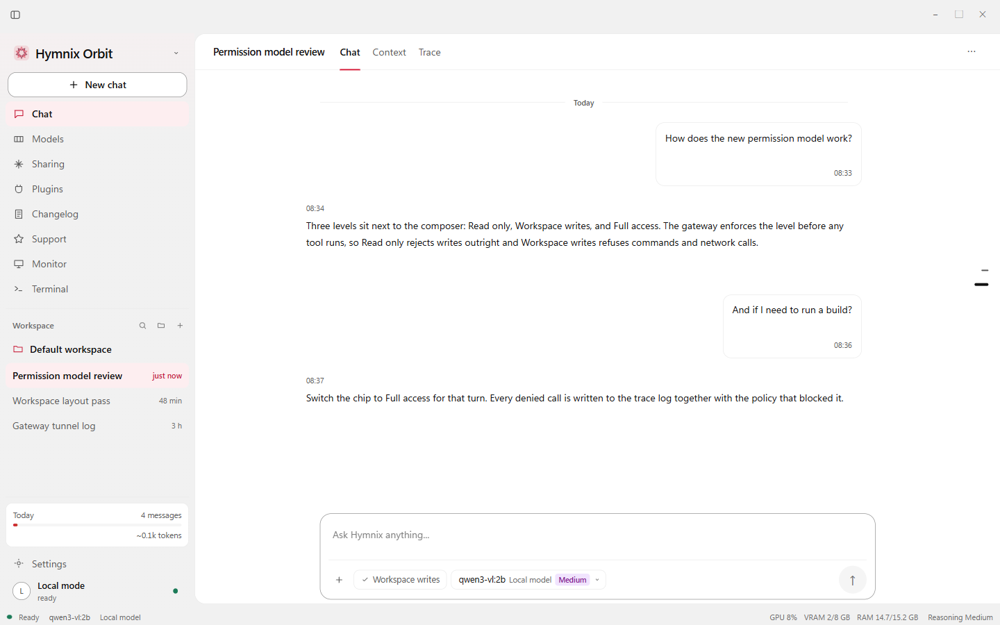
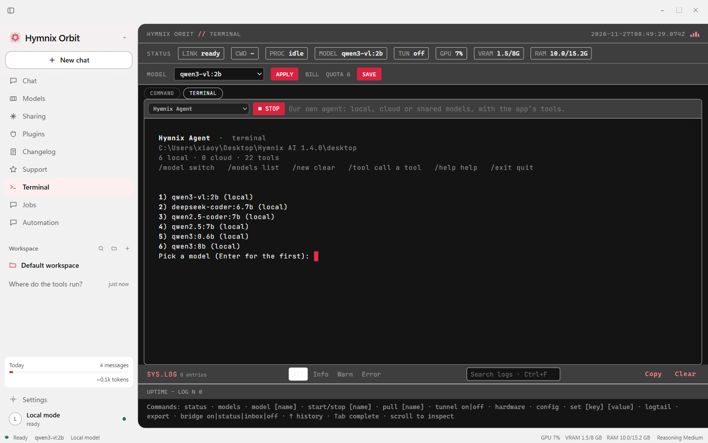
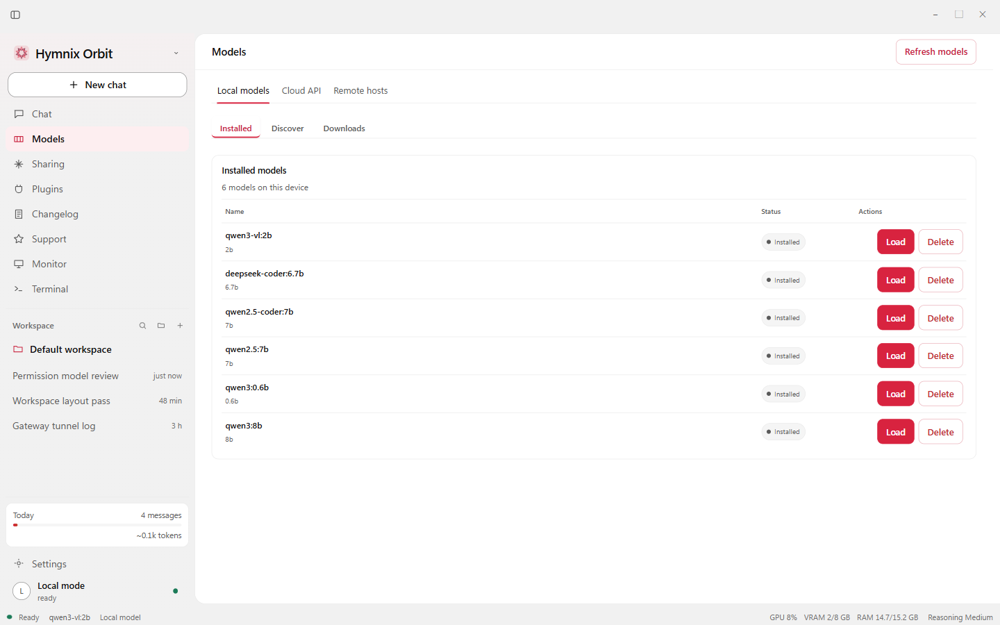
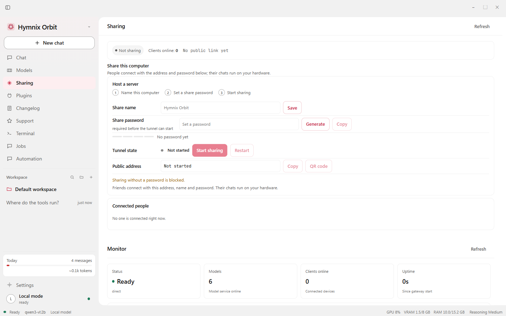

# Hymnix Orbit

**面向 Windows 的本地优先 AI 工作台。** 模型可以跑在自己的机器上、直接连云端 API，也可以用朋友共享给你的算力——配上真终端、真工具，以及**留在文件所在那台机器上**的审批。

[](https://github.com/CarrisFlynn/hymnix-ai-server/releases)
[](LICENSE)
[](#环境要求)

**简体中文** · [English](README.md) · [更新日志](CHANGELOG.zh-CN.md) · [安全](SECURITY.md)

---

## 截图

| | |
|---|---|
|  |  |
| **Orbit 对话** —— 代理循环，计划与轨迹就在同一页。 | **终端** —— 真 PTY：自带 agent、PowerShell、Claude Code、Codex、Gemini、Ollama、Git Bash。 |
|  |  |
| **模型** —— 本地模型、下载、硬件信息集中在一处。 | **共享** —— 借出你的算力，或连上愿意借的人。 |

---

## 它是什么

两个界面，一条原则：

- **Orbit** —— 干活的代理：会读、会改、会跑，动手前先问。
- **Hymnix AI** —— 只想问一句时的普通对话。

原则是：**模型可以待在任何地方，活要在文件所在的那台机器上干。**

| 你的需求 | 实际发生的事 |
|---|---|
| 用自己装的模型 | Ollama 本地跑，什么都不外传 |
| 用云端模型 | 用自己的 key 直连服务商，与网关无关 |
| 用朋友的机器 | 他的模型来答，**你的**电脑来执行工具 |

---

## 快速开始

### 安装

到 [Releases](https://github.com/CarrisFlynn/hymnix-ai-server/releases) 下载 `Hymnix-Orbit-1.5.0-Setup.exe`，或用免安装的 Portable 版。Node 已随包内置，终端里的自带 agent 开箱即用。

### 准备模型

装好 [Ollama](https://ollama.com) 后拉一个模型：

```powershell
ollama pull qwen3:8b
```

不想跑本地模型也行：**设置 → 模型 → API**，加一个服务商即可。

### 从源码运行

```powershell
pnpm install
pnpm build            # 渲染层与主进程
pnpm build:backend    # Python 网关（可选，共享时需要）
pnpm dev              # 开发构建，带探针钩子
```

---

## 功能

### 代理（Orbit）
一个循环：规划、调用工具、把过程摊开给你看。上下文、计划、轨迹与对话同页不同标签，回答之前它读过什么一目了然。

### 终端
真 PTY，不是日志列表——有光标定位、原始按键、备用屏幕。所以终端页能装下：

- **Hymnix Agent** —— 本应用内核的 CLI 形态：同一批工具、同一套审批，在终端里以 `y/N` 呈现。
- **Claude Code、Codex、Gemini、Ollama、Git Bash、PowerShell** —— 探测得出，不是写死。

CLI 本身不带工具、不带 provider 逻辑：一个每次启动换令牌的回环桥持有两者，所以模型是本地、云端还是别人共享的，它都不需要知道。

### 工具
53 个工具，覆盖文件、补丁、仓库、命令、终端、网页、模型、会话、任务、计划、技能与子代理。文件、补丁、仓库、命令、终端、抓网页这六类**跑在桌面进程自己身上**，网关关着照常可用——那本来就是常态。

搬家时搬的是功能，也是边界：路径先取 realpath 再判包含、`web.fetch` 拒绝私网（含 IPv4 映射地址）并把校验过的 IP 钉在连接上、超时命令连进程树一起杀。

### 审批
任何写入、删除、执行都会先问。策略就在输入框旁边：**只读**、**工作区内修改**、**完全访问**。被拒绝的调用同样会记进轨迹，并标注是哪条策略挡下的。

### 模型与硬件
本地模型的加载/卸载与显存读数、可下载的模型目录、按服务商配置的 key，以及一条告诉你这台机器能装下什么的硬件栏。

### 共享
借出算力，或使用朋友的：

1. **宿主** —— 起名、设密码、开始共享，得到公网地址与二维码。
2. **访客** —— 填地址与密码。对方的模型出现在你的模型列表里，**你的文件不会离开你的电脑**。

共享会话只跑 Orbit（目的是干活，不是闲聊），且访客访问 `/api/tools` 与 `/api/files` 一律被拒：宿主提供的是算力，不是磁盘。共享端点同时支持 OpenAI 与 Anthropic Messages，Claude Code 或 Anthropic SDK 都能直接连。

### 还有
带权限模型的插件、自动化任务、工作树、技能、子代理、用量与成本统计、跟随 Windows 的九套主题，以及中英双语界面。

---

## 架构

```text
桌面端（Electron）                     可选的网关（Python）
  renderer —— 界面、代理循环              只为共享而生：
  main     —— 工具、PTY、LSP、回环桥      隧道、配额、共享模型
```

**网关不是必需的**，它存在的唯一理由是让一台机器能把自己有的东西共享出去。细节见 [docs/ARCHITECTURE.md](docs/ARCHITECTURE.md)。

---

## 环境要求

- Windows 10（1809+）或 Windows 11，x64
- 内存 8 GB 起；跑较大的模型建议 16 GB 以上
- 本地模型需要 [Ollama](https://ollama.com)（可选）
- 只有从源码跑网关时才需要 Python 3.11+

---

## 仓库结构

| 路径 | 内容 |
|---|---|
| `desktop/src/main` | Electron 主进程：工具、PTY、回环桥、provider、LSP |
| `desktop/src/renderer` | React 界面（单个 IIFE bundle，保证 `file://` 可用） |
| `desktop/cli` | 终端里的 agent |
| `desktop/tests` | 行为测试（`node:test`） |
| `server/` | Python 网关：共享、隧道、配额 |
| `server/tests` | 网关与协议测试 |
| `docs/` | 架构、运维、安全、发布说明 |

---

## 构建

```powershell
pnpm check            # 类型检查 + 测试 + 设计令牌 + 构建
pnpm dist             # 渲染层、后端、安装包，输出到 release/
pnpm smoke:prod       # 启动打包产物做冒烟
```

打包时会带上 Node，并把语言服务器打成单个归档——因为打包器会剪掉任何含 `node_modules` 的目录。

---

## 安全

- 工具与文件对访客一律拒绝：宿主不会替别人读自己的磁盘。
- 共享端点把错误 key 计入封禁，并遵守每日配额。
- 所有路径在做包含判断之前先解析到真实位置。
- 任何写入或执行之前都必须审批。

见 [SECURITY.md](SECURITY.md) 与 [docs/SECURITY.md](docs/SECURITY.md)。

---

## 更新日志

[CHANGELOG.zh-CN.md](CHANGELOG.zh-CN.md) · [English](CHANGELOG.md)

---

## 许可证

[AGPL-3.0](LICENSE)。商业授权可另行洽谈。

## 参与

欢迎提 issue 与 PR——见 [CONTRIBUTING.md](CONTRIBUTING.md) 与 [CODE_OF_CONDUCT.md](CODE_OF_CONDUCT.md)。
